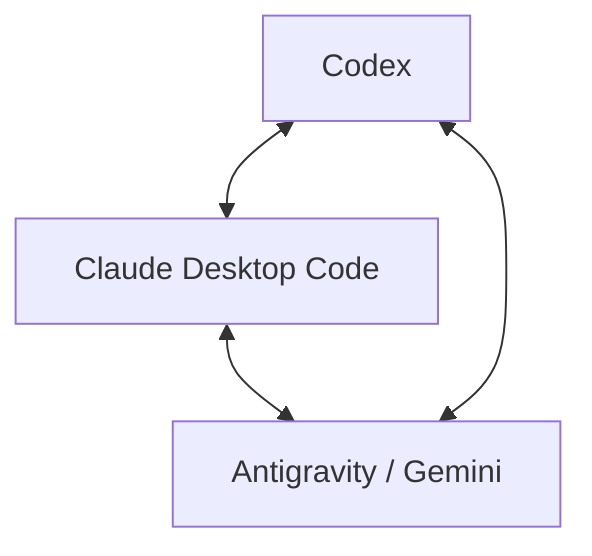

# Triangle Bridge

Connect **Codex**, **Claude Desktop Code**, and **Antigravity (Gemini)** desktop sessions from any of the three apps.

Three target adapters provide session discovery, exact ID routing, creation, approval settings, message delivery, and response reading. The sending model uses the same codebase in every direction.



## Install

Requires **Windows** and **Node.js 22 or later**. Install and sign in to the desktop apps that will participate, and keep them running.

```powershell
npm install --global git+https://github.com/heelee912/triangle-bridge.git
triangle-bridge --help
triangle-bridge status --cwd "C:\Projects\Example"
```

Installation is through GitHub using npm. No npm registry publication is required for this command. There are no third-party runtime dependencies, API keys, personal checkout paths, or background bridge server to configure.

Install the same self-contained skill into all three apps:

```powershell
triangle-bridge install-skills
```

The installer derives the current user's home and writes only the packaged skill resources:

- Codex: `$CODEX_HOME/skills/triangle-bridge`, or `~/.codex/skills/triangle-bridge`.
- Claude Desktop Code: `~/.claude/skills/triangle-bridge`.
- Antigravity: `~/.gemini/config/skills/triangle-bridge`.

Invoke `triangle-bridge` as a skill in a session after the app refreshes its skill list. Bundled scripts work independently of the original Git checkout and npm install location. Repeating the installer updates its own listed files and preserves unrelated files.

## Commands

Use the target app name after `triangle-bridge`. A standalone `codex-bridge`, `claude-code-bridge`, and `antigravity-bridge` command is also installed.

### Discover and select a session

```powershell
triangle-bridge status --cwd "C:\Projects\Example"
triangle-bridge codex list --cwd "C:\Projects\Example"
triangle-bridge claude code list --cwd "C:\Projects\Example" --json
triangle-bridge antigravity list --cwd "C:\Projects\Example"
```

Use the returned exact session ID for sends and reads. The bridge checks the target before sending and does not select the focused or newest recipient. If an app or its native endpoint is unavailable, status reports that app's error while returning the other app results.

Codex discovery uses an existing Desktop-known thread as a read-only caller context. Supply `--context-thread <known-local-desktop-id>` explicitly if discovery cannot resolve one. This context is not a message recipient and does not start a model turn.

### Send and read

Save the message in a UTF-8 file, such as `message.txt`:

```powershell
triangle-bridge codex send --thread <codex-id> --prompt-file .\message.txt
triangle-bridge codex read --thread <codex-id> --turn-limit 2

triangle-bridge claude code send --session-id <claude-id> --prompt-file .\message.txt --wait --json
triangle-bridge claude code read --session-id <claude-id> --lines 10 --json

triangle-bridge antigravity send --session-id <antigravity-id> --prompt-file .\message.txt --wait
triangle-bridge antigravity read --session-id <antigravity-id>
```

Claude accepts its exact Desktop `local_…` ID or the corresponding internal session ID. Normal sends use visible ordinary user inputs, including the app-owned stream-json path when the renderer API is unavailable. The target model and approval mode are preserved.

Antigravity attaches a request UUID to each input and selects its matching response. `--model <native-model-id-or-label>` is optional; the existing selected model is used otherwise.

`app-acknowledged` and `written-unconfirmed` mean acceptance or a pipe write. Read the response before claiming completed work. Claude `--wait` confirms a matching assistant text entry, which may precede completion of tools. Antigravity `reply-complete` confirms the tagged input's response after the session becomes idle.

A lost acknowledgement is `unknown` and is never automatically resent. The local outbox records IDs, hashes, and states without storing prompt text. Reconcile the existing request:

```powershell
triangle-bridge claude code peer-receipt --session-id <claude-id> --message-id <request-uuid> --json
triangle-bridge antigravity read --session-id <antigravity-id> --request-id <request-uuid>
```

### Create a desktop session and assign approvals

```powershell
triangle-bridge codex create --cwd "C:\Projects\Example" --title "Bridge task" --prompt-file .\message.txt --mode always-proceed
triangle-bridge claude code create --cwd "C:\Projects\Example" --title "Bridge task" --prompt-file .\message.txt --permission-mode bypassPermissions --json
triangle-bridge antigravity create --cwd "C:\Projects\Example" --title "Bridge task" --prompt-file .\message.txt --mode always-proceed --scope project --wait
```

| App | Creation | Approval scope |
| --- | --- | --- |
| Codex | Native `create_thread`; folder must be a registered local project | Exact thread; `always-proceed` or `request-review` |
| Claude Desktop Code | Desktop's installed child binary initializes a fresh transcript; the native resume link imports it into Desktop and exact metadata confirms it | Exact Code session; `default`, `acceptEdits`, `plan`, `auto`, or `bypassPermissions` |
| Antigravity | Native conversation creation; reuses the project matching the folder | **Entire project**, explicitly acknowledged by `--scope project`; Turbo or Request Review |

Codex creates an inert initial turn when `--mode` is requested, confirms the mode, then sends the task prompt. Claude uses the current Desktop sign-in for creation without writing a separate credential file. An imported bypass session is updated through the native runtime control and confirmed in Desktop metadata. If creation partially succeeds, retain its returned ID and recover that session instead of creating another.

Antigravity permissions persist per project and affect its other conversations. A conversation outside a project can send/read, but cannot take a project approval preset. If multiple projects use a folder, pass the exact `--project-id` during creation.

For existing sessions:

```powershell
triangle-bridge codex set-permission-mode --thread <codex-id> --mode always-proceed
triangle-bridge codex settings --thread <codex-id>
triangle-bridge claude code set-permission-mode --session-id <claude-id> --mode bypassPermissions --json
triangle-bridge antigravity set-permission-mode --session-id <antigravity-id> --mode always-proceed --scope project
```

Approval changes use native app controls and verify readback. Ordinary message delivery does not change permissions. Claude can only switch to `bypassPermissions` when the Desktop child was launched with the corresponding allow/skip flag.

## Native transports

- **Codex:** the running app's named-pipe tool endpoint for session operations; its desktop owner protocol for settings.
- **Claude Desktop Code:** existing renderer/raw session APIs, then verified app-owned live stdin with replayed visible user inputs. Explicit native `peer` transport is retained; its meta messages can be hidden in the UI.
- **Antigravity:** its existing local desktop debugger endpoint, native product identity check, authenticated language-server client, and runtime protobuf descriptors. No browser instance is started.

These adapters operate on user desktop sessions. A separate model CLI resume or web chat is not an automatic fallback. No app binaries are patched and apps are not restarted. Claude Cowork requires its existing renderer/raw API; the tested three-app flow uses Claude Desktop Code.

Codex remote targets can use `--context-thread <local-id> --host-id <observed-host>` for native send/read. Approval settings in this release target the local desktop host. Use the adapter's `--help` for additional receipt and diagnostic commands.

## Development and verification

```powershell
npm run check
npm test
npm pack --dry-run
```

The test suite covers exact session isolation, Unicode transport, unknown delivery, duplicate unconfirmed sends, visible Claude frames, native project discovery, protobuf model/settings serialization, and permission readback. Package contents exclude tests and local app state.

The three apps were exercised in all six send/read directions on Windows, including new desktop sessions and approval readback. Tested versions: Codex 26.1007.2314.0, Claude Desktop 2.31226.1.0 (Code child 2.1.295), Antigravity 2.22.0. These native internal interfaces can change with app updates; errors are reported explicitly rather than switching to unrelated sessions.

See [SECURITY.md](SECURITY.md) for local data handling. Licensed under MIT.
